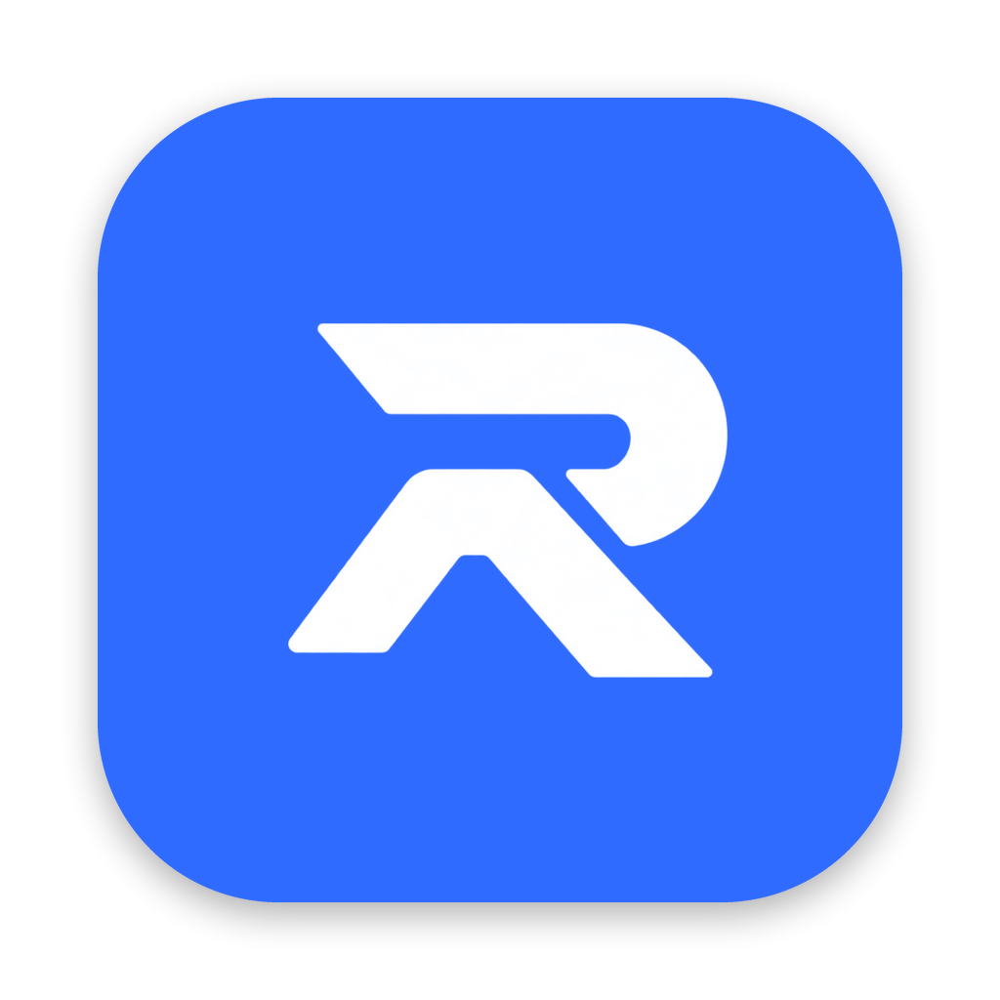
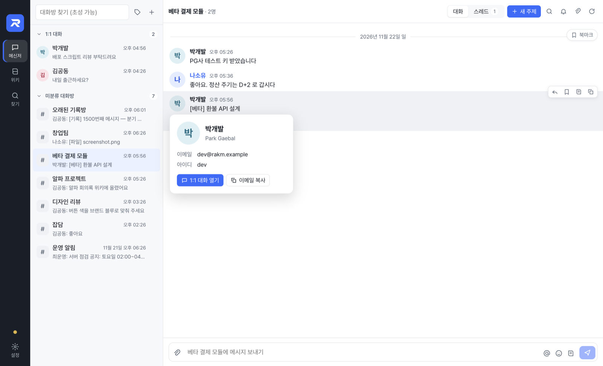
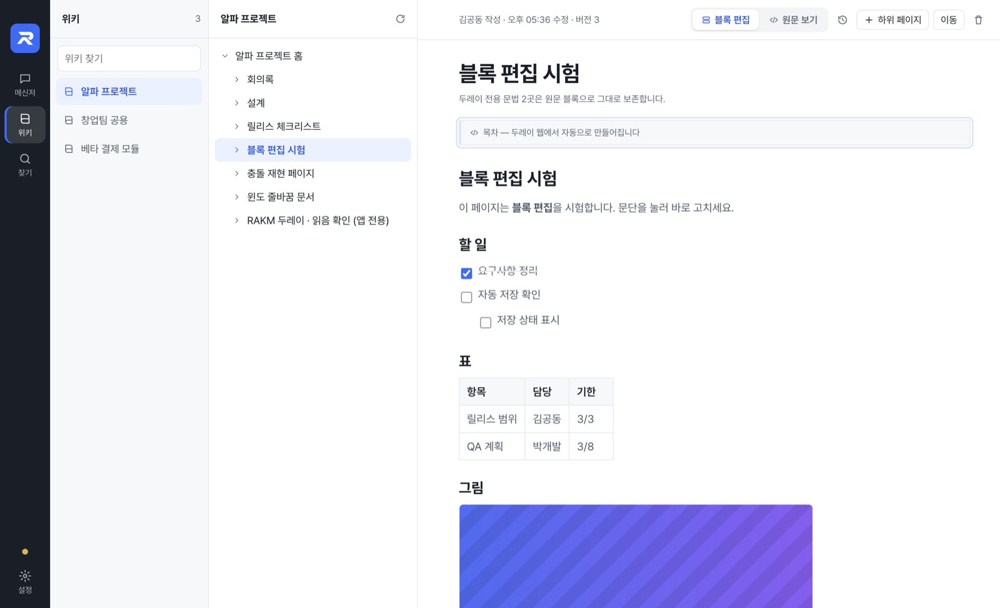
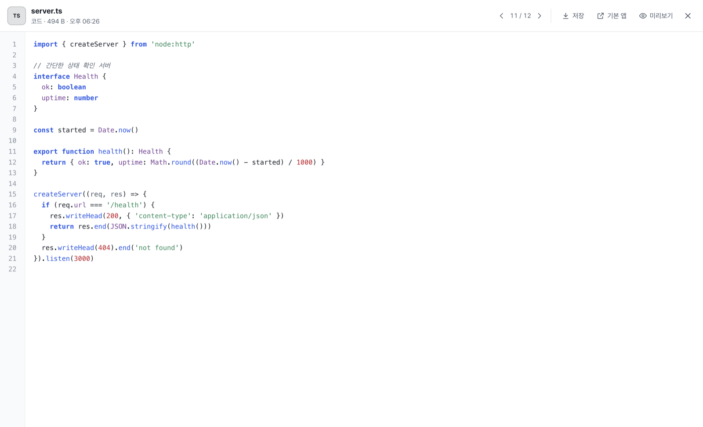
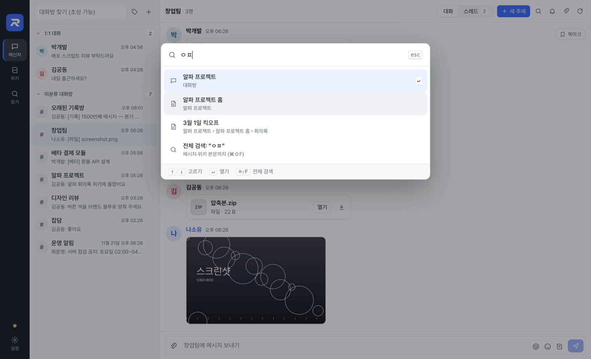
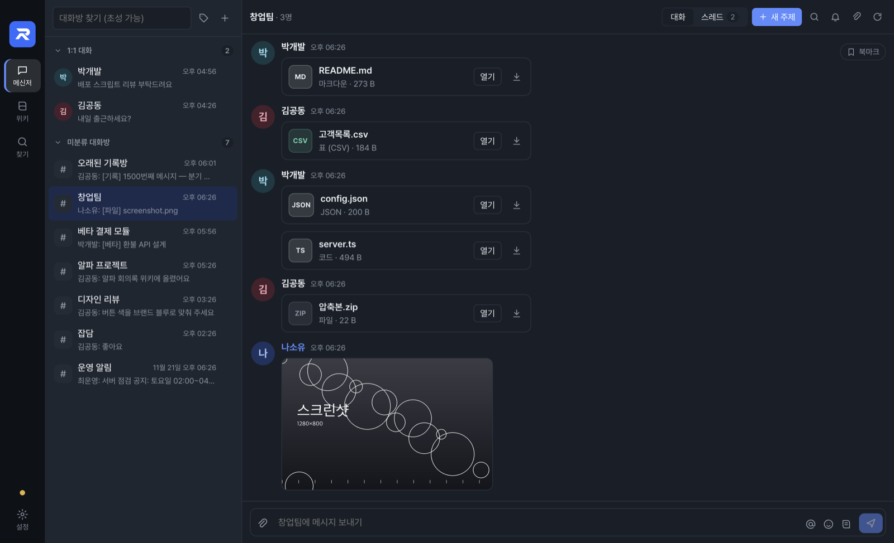

<p align="center">
  
</p>

<h1 align="center">RAKM 두레이</h1>

<p align="center">
  두레이 메신저와 위키를 한 창에서 빠르게 쓰는 macOS 데스크톱 앱
</p>

<p align="center">
  <a href="https://github.com/Rakmlabs/rakm-dooray/releases/latest"></a>
  
</p>

> **NHN Dooray! 비공식 클라이언트입니다. NHN 및 NHN Dooray 와 무관하며, NHN 이 만들거나 보증하지 않습니다.**
> 두레이의 공개 API 와 각자 발급한 개인 API 토큰으로 동작합니다.

*An unofficial macOS desktop client for NHN Dooray! messenger and wiki (Korean UI, not affiliated with NHN).*

> [!NOTE]
> 지금은 연결할 회사 도메인이 `rakm.dooray.com` 으로 고정돼 있어, 다른 회사는 그대로 쓸 수 없습니다.



## 두레이 웹과 다른 점

- **빠른 이동 ⌘K** — 대화방·사람·위키 페이지를 초성(`ㅇㅍ`)으로 찾아 바로 엽니다. ⌘⇧F 로 메시지·위키 본문 전체 검색.
- **오래된 메시지도 검색** — 받은 메시지를 이 컴퓨터에 쌓아, 두레이가 주는 최신 1000개 이전까지 보이고 검색됩니다.
- **대화방 정리** — 즐겨찾기, 프로젝트 폴더, 끌어 놓아 순서 바꾸기, 숨기기, 방별 알림 끄기.
- **코드 블록·인라인 코드** — 슬랙처럼 ` ``` ` 로 코드를 넣고(⌘⇧C 인라인, ⌘⌥C 블록, ⌘⇧U 링크), 언어를 적으면 색이 입혀지며, 마우스를 올리면 복사 버튼이 나옵니다. 두레이 웹·모바일에서도 코드 블록으로 보이는 형식으로 보냅니다.
- **주제별 스레드 (선택)** — 기본은 꺼져 있습니다. 설정 › 채팅 › "스레드 기능 쓰기"를 켜면 "새 주제"로 `[프로젝트] 제목` 스레드를 열고 프로젝트별로 모아 봅니다. 꺼 두어도 대화에 달린 스레드는 열어 읽고 지울 수 있습니다.
- **위키 블록 편집** — 문단을 눌러 바로 고치고, `/` 메뉴로 블록을 넣고, 자동 저장합니다. 저장 전에 서버 버전을 확인하고 원문을 백업합니다.
- **파일을 앱 안에서** — 이미지·PDF·docx·xlsx·코드 등을 내려받지 않고 봅니다.
- **알림과 읽음 확인** — 새 메시지 알림, Dock 배지, 내 메시지를 상대가 읽었는지 표시 (아래 '읽음 확인').
- **다크 모드**, 글자 크기, 메뉴 막대 상주, 로그인 시 자동 실행.

<table>
  <tr>
    <td width="50%"><br><sub>위키 블록 편집</sub></td>
    <td width="50%"><br><sub>앱 안 파일 뷰어</sub></td>
  </tr>
  <tr>
    <td width="50%"><br><sub>⌘K 빠른 이동 (초성 검색)</sub></td>
    <td width="50%"><br><sub>다크 모드</sub></td>
  </tr>
</table>

<sub>스크린샷은 모의 서버 화면입니다. 사람·대화·파일은 모두 가상입니다.</sub>

## 설치

Apple Silicon Mac, macOS 12 이상.

1. [최신 릴리스](https://github.com/Rakmlabs/rakm-dooray/releases/latest)에서 `RAKM-Dooray-<버전>-arm64.dmg` 를 내려받습니다.
2. dmg 를 열고 `RAKM Dooray` 를 **응용 프로그램** 폴더로 끌어 놓습니다. Apple 공증을 받은 앱이라 바로 열립니다.
3. 처음 켜면 설정 화면이 뜹니다. **자기 두레이 개인 API 토큰**을 붙여 넣습니다.
   - 발급 위치: 두레이 웹 → 오른쪽 위 프로필 → **개인 설정 › API › 개인 인증 토큰** 에서 "토큰 생성".
     설정 화면의 "여기서 발급" 버튼이 이 화면을 엽니다. 메뉴가 보이지 않으면 회사 관리자에게 요청하세요.
   - 토큰은 다른 사람과 공유하지 마세요. 사람마다 자기 토큰을 씁니다.
4. macOS 가 **알림 허용**을 물으면 "허용"을 누릅니다. 알림 권한이 없으면 macOS 는 새 메시지 알림뿐 아니라 **Dock 배지도 숨깁니다.**
   알림이 꺼져 있으면 메신저 화면 위와 설정 › 알림에 "알림이 꺼져 있음 · 시스템 설정 열기" 가 보입니다.
   "시스템 설정 열기" 를 누르면 이 앱의 알림 화면이 바로 열리니, 맨 위 **"알림 허용"** 을 켜세요. 켜면 안내가 저절로 사라집니다.

## 자동 업데이트

- 앱을 켤 때와 4시간마다 새 버전을 확인하고 뒤에서 받아 둡니다.
- 다 받으면 화면 위에 **"새 버전 x.y.z 준비됨 · 재시작"** 이 뜹니다. 재시작하지 않으면 다음에 앱을 끌 때 설치됩니다.
- 재시작 전에 위키 자동 저장과 읽음 위치 기록을 마무리하므로 쓰던 내용은 남습니다.
- 같은 개발자 서명과 Apple 공증을 받은 새 버전만 설치합니다.
- 설정 › 업데이트에서 지금 버전, 마지막 확인 결과, "지금 확인" 버튼을 볼 수 있습니다. 확인에 실패해도 화면을 가리지 않습니다.
- 0.1.2 이하에서 올라올 때는 0.1.3 을 한 번 직접 설치해야 합니다. 그 다음부터 자동입니다.

## 읽음 확인

내 메시지 옆에 아직 읽지 않은 사람 수(노란 `1`)가 떴다가, 상대가 읽으면 사라집니다. 설정 › 읽음 확인에서 끌 수 있습니다.

두레이에는 "누가 읽었는지"를 알려 주는 API 가 없습니다. 그래서 **양쪽 모두 이 앱을 쓸 때** 앱끼리 두레이 위키의 전용 페이지
(`RAKM 두레이 · 읽음 확인 (앱 전용)`)에 "어느 방을 어디까지 읽었는지"만 적어 주고받습니다. 메시지 내용은 적지 않습니다.

한계:

- 상대가 두레이 **모바일·웹**에서 읽은 것은 알 수 없습니다. 그 뒤 상대가 답을 보냈다면 읽은 것으로 봅니다.
- 상대가 이 앱을 쓰지 않거나 기능을 꺼 두었으면 숫자를 띄우지 않습니다. 3명 이상 방은 기록이 있는 사람만 셉니다.
- 위키 페이지에 버전 기록이 쌓입니다.

**안 읽음 수**도 같은 이유로 이 컴퓨터에서 계산합니다. 다른 기기에서 읽어도 이 앱의 안 읽음은 줄지 않고, 스레드 답글은 세지 않습니다.

## 개인정보

- 별도 서버가 없습니다. 데이터는 **이 컴퓨터**와 **두레이**에만 있습니다.
- 토큰은 macOS 키체인으로 암호화해 이 컴퓨터에만 저장합니다.
- 받은 메시지 보관본과 설정은 `~/Library/Application Support/dooray-client` 에 있습니다. 앱과 이 폴더를 지우면 남는 것이 없습니다.
- 두레이 말고 접속하는 곳은 업데이트 확인(이 저장소의 GitHub 릴리스)과, 켜 둔 경우 메시지 속 링크의 미리보기뿐입니다.

## 알려진 제약

- **메일 없음** — 두레이 메일은 IMAP 으로만 읽을 수 있는데 Free 플랜에서는 IMAP 을 쓸 수 없어 화면에서 뺐습니다.
- **두레이 읽음 상태와 연동 안 됨** — 두레이 서버의 "읽음"을 읽거나 쓰는 API 가 없습니다. 이 앱에서 읽어도 두레이 웹·모바일에는 안 읽음으로 남습니다.
- **실시간 수신 없음** — 공식 실시간 API 가 없어 몇 초 간격으로 새 메시지를 확인합니다 (보고 있는 방은 3초, 창이 뒤에 있으면 10초).
- 대화방마다 두레이가 주는 메시지는 최신 1000개까지입니다. 그 이전은 이 앱이 받아 둔 것만 보입니다.
- "나와의 대화"는 목록에 나오지 않습니다.
- **메시지 삭제 시간 제한** — 두레이는 조직 설정의 "메시지 삭제 가능 시간"(기본 5분)이 지난 메시지를 API·웹 모두에서 지우지 못하게 합니다. 오래된 스레드는 지울 수 없어 목록에서 숨기기만 됩니다. 관리자가 두레이 관리 화면에서 이 시간을 늘릴 수 있습니다.
- 두레이에는 스레드를 통째로 지우는 기능이 없습니다. 스레드 삭제는 내 메시지를 하나씩 지우는 것이라, 남의 답글이 있으면 스레드가 남습니다.
- 회사 도메인이 `rakm.dooray.com` 으로 고정돼 있습니다.
- macOS Apple Silicon 용만 배포합니다.

## 개발

빌드, 토큰 없이 모의 서버로 실행하기, 배포 절차, 코드 구조는 [docs/DEVELOPMENT.md](docs/DEVELOPMENT.md) 에 있습니다.

```sh
npm install
node scripts/mock-dooray.mjs                         # 모의 두레이 서버 (127.0.0.1:8787)
DOORAY_MOCK_BASE=http://127.0.0.1:8787 npm run dev   # 가짜 데이터로 실행
```

## 라이선스

[MIT](LICENSE) © 2026 Rakmlabs
